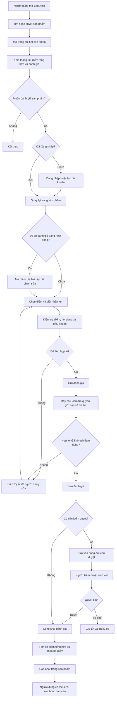
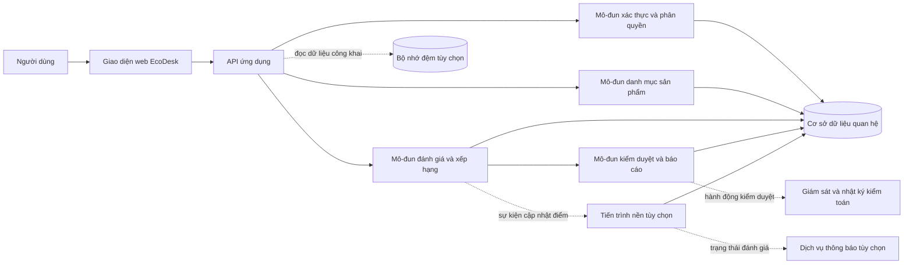
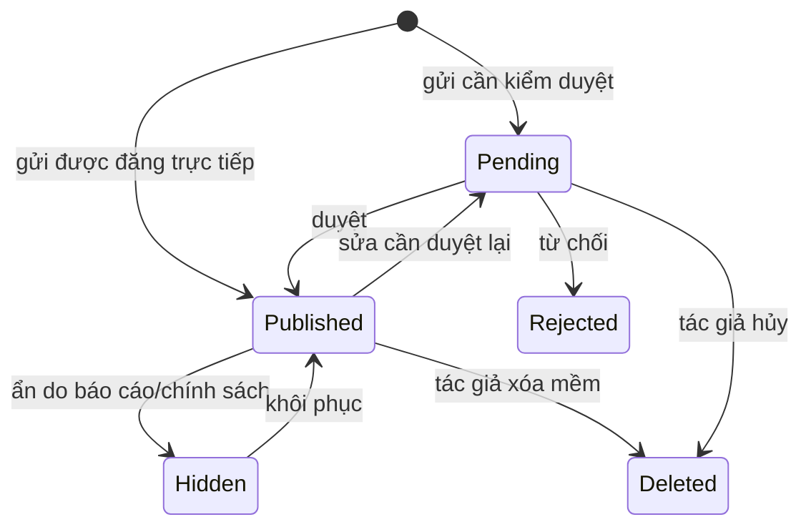

# EcoDesk — Thiết kế kiến trúc phần mềm: Đánh giá sản phẩm

> **Trạng thái:** thiết kế đề xuất, cần đối chiếu với mã nguồn hiện tại.  
> **Phạm vi:** người dùng chấm điểm và viết đánh giá sản phẩm; xem điểm tổng hợp; chỉnh sửa, báo cáo và kiểm duyệt đánh giá.

## 1. Mục tiêu

Tài liệu mô tả workflow và kiến trúc logic cho chức năng đánh giá sản phẩm của EcoDesk. Đánh giá gồm điểm số có cấu trúc và phần nhận xét giải thích trải nghiệm. Đây là thiết kế đề xuất; tên framework, dịch vụ và API cần điều chỉnh theo cấu trúc thực tế của dự án.

## 2. Giả định và quy tắc nghiệp vụ

- Khách có thể xem sản phẩm, điểm trung bình và các đánh giá công khai.
- Người dùng cần đăng nhập để gửi hoặc chỉnh sửa đánh giá.
- Mỗi người dùng có tối đa một đánh giá đang hoạt động cho mỗi sản phẩm; có thể cập nhật đánh giá đó.
- Điểm tổng thể dùng thang 1–5. Điểm theo tiêu chí (nếu có) là tùy chọn và được lưu riêng.
- Đánh giá được công khai ngay hoặc chuyển chờ duyệt tùy chính sách và tín hiệu rủi ro.
- Chỉ đánh giá đã duyệt và chưa bị xóa mới được tính vào điểm tổng hợp.
- Tài liệu này tập trung vào đánh giá có chấm điểm. Thảo luận nhiều lượt và phản hồi lồng nhau thuộc tính năng bình luận riêng.

## 3. Workflow đánh giá sản phẩm

### Các bước xử lý

1. Trang sản phẩm hiển thị điểm trung bình, số lượng đánh giá, phân bố điểm và danh sách đánh giá công khai có phân trang.
2. Khi người dùng chọn đánh giá, hệ thống yêu cầu đăng nhập và tải đánh giá hiện có của họ nếu có.
3. Giao diện kiểm tra trường bắt buộc và phạm vi điểm để phản hồi nhanh. Máy chủ luôn kiểm tra lại dữ liệu, quyền sở hữu, trạng thái sản phẩm và giới hạn tần suất.
4. Máy chủ lưu đánh giá với trạng thái ban đầu `pending` hoặc `published`. Tạo mới hoặc cập nhật phải tuân thủ quy tắc một đánh giá đang hoạt động cho mỗi người dùng/sản phẩm.
5. Đánh giá được duyệt mới tham gia tính điểm trung bình và phân bố. Khi đánh giá bị ẩn, xóa hoặc chuyển trạng thái, phần tổng hợp phải được cập nhật.
6. Người dùng có thể sửa đánh giá của mình. Tùy chính sách, bản sửa có thể cần duyệt lại; phiên bản trước và lịch sử kiểm duyệt cần được lưu phù hợp.
7. Báo cáo đánh giá tạo một mục trong hàng đợi kiểm duyệt. Báo cáo không tự động làm thay đổi điểm số trừ khi nội dung bị chuyển khỏi trạng thái công khai.

## 4. Kiến trúc logic

### Trách nhiệm các thành phần

| Thành phần | Trách nhiệm |
|---|---|
| Giao diện web | Tìm sản phẩm, hiển thị điểm và đánh giá, biểu mẫu chấm điểm, trạng thái gửi, sửa/xóa và báo cáo. |
| API ứng dụng | Kiểm tra yêu cầu, điều phối xử lý, phân trang, giới hạn tần suất và trả lỗi theo định dạng thống nhất. |
| Xác thực và phân quyền | Xác định tài khoản; bảo đảm người dùng chỉ sửa hoặc xóa đánh giá của mình và chỉ nhân sự có quyền mới kiểm duyệt được. |
| Danh mục sản phẩm | Cung cấp thông tin sản phẩm và xác nhận sản phẩm còn cho phép đánh giá. |
| Đánh giá và xếp hạng | Tạo/sửa/xóa đánh giá, xác thực điểm, truy vấn danh sách và quản lý dữ liệu tổng hợp. |
| Kiểm duyệt và báo cáo | Quản lý hàng đợi, báo cáo, quyết định duyệt/từ chối/ẩn/khôi phục và lịch sử quyết định. |
| Tiến trình nền (tùy chọn) | Tính lại điểm tổng hợp, xử lý tác vụ có thể thử lại và phát sự kiện sau khi trạng thái đánh giá đổi. |
| Cơ sở dữ liệu | Lưu đánh giá nguồn, báo cáo, quyết định và/hoặc bản tổng hợp điểm. |
| Bộ nhớ đệm (tùy chọn) | Tăng tốc trang sản phẩm phổ biến; làm mới khi dữ liệu đánh giá công khai thay đổi. |
| Thông báo (tùy chọn) | Báo cho tác giả về trạng thái đánh giá hoặc phản hồi kiểm duyệt; lỗi thông báo không làm mất dữ liệu. |

## 5. Mô hình dữ liệu logic

- **User**: `id`, trạng thái tài khoản, tên hiển thị, thời điểm tạo.
- **Product**: `id`, trạng thái, thông tin định danh và cấu hình cho phép đánh giá.
- **Review**: `id`, `product_id`, `author_id`, điểm tổng thể, tiêu đề, nội dung, trạng thái, thời điểm tạo/cập nhật, thời điểm xóa mềm, số phiên bản.
- **ReviewCriterionScore** (tùy chọn): `review_id`, tên tiêu chí, điểm; dùng cho các tiêu chí như chất lượng, độ bền hoặc giá trị.
- **ReviewReport**: `id`, `review_id`, `reporter_id`, lý do, trạng thái xử lý, thời điểm tạo.
- **ModerationAction**: `id`, `review_id`, `moderator_id`, quyết định, lý do, thời điểm tạo.
- **RatingSummary** (dữ liệu dẫn xuất): `product_id`, số đánh giá được duyệt, tổng điểm, điểm trung bình, phân bố theo mức điểm, thời điểm cập nhật.

Ràng buộc dữ liệu nên bảo đảm điểm nằm trong khoảng cho phép, các khóa ngoại hợp lệ và một đánh giá đang hoạt động cho mỗi cặp `(product_id, author_id)`. Có thể lưu bản tổng hợp để tăng tốc đọc, nhưng phải có cách dựng lại từ các đánh giá đã duyệt. Thời gian lưu theo UTC; quy định rõ cách xử lý nội dung khi người dùng xóa tài khoản.

## 6. API tham khảo

| Phương thức và đường dẫn | Mục đích | Quyền truy cập |
|---|---|---|
| `GET /api/products` | Tìm kiếm và lọc sản phẩm | Công khai |
| `GET /api/products/{id}` | Chi tiết sản phẩm và tóm tắt xếp hạng | Công khai |
| `GET /api/products/{id}/reviews` | Danh sách đánh giá đã duyệt có phân trang | Công khai |
| `GET /api/products/{id}/my-review` | Lấy đánh giá hiện tại của người dùng cho sản phẩm | Đã đăng nhập |
| `POST /api/products/{id}/reviews` | Tạo đánh giá | Đã đăng nhập |
| `PATCH /api/reviews/{id}` | Sửa đánh giá của mình | Tác giả hoặc quản trị theo chính sách |
| `DELETE /api/reviews/{id}` | Xóa mềm đánh giá của mình | Tác giả hoặc quản trị theo chính sách |
| `POST /api/reviews/{id}/reports` | Báo cáo đánh giá | Đã đăng nhập |
| `GET /api/moderation/reviews` | Xem hàng đợi kiểm duyệt | Kiểm duyệt viên |
| `POST /api/moderation/reviews/{id}/decision` | Duyệt, từ chối, ẩn hoặc khôi phục | Kiểm duyệt viên |

Đường dẫn API chỉ mang tính minh họa và cần tuân theo quy ước hiện tại của EcoDesk. Các thao tác tạo/sửa nên hỗ trợ xử lý thử lại an toàn để tránh tạo dữ liệu trùng khi mạng chập chờn.

## 7. Vòng đời đánh giá

Máy chủ là nơi duy nhất quyết định trạng thái hợp lệ. Chỉ trạng thái `Published` được đưa vào danh sách công khai và phép tính điểm tổng hợp.

## 8. Bảo mật và yêu cầu chất lượng

- **Phân quyền:** kiểm tra quyền ở máy chủ cho mọi thao tác; không tin trạng thái hoặc vai trò do trình duyệt gửi lên.
- **Kiểm tra nội dung:** giới hạn độ dài, kiểm tra điểm và mã hóa đầu ra để ngăn XSS; không render HTML tùy ý.
- **Chống lạm dụng:** giới hạn tần suất đánh giá/sửa/báo cáo; phát hiện gửi lặp hoặc spam theo chính sách.
- **Quyền riêng tư:** chỉ thu thập thông tin cần thiết; giới hạn truy cập hàng đợi kiểm duyệt; tránh ghi nội dung đánh giá và thông tin xác thực vào log.
- **Trợ năng:** biểu mẫu dùng được bằng bàn phím, bộ chọn điểm có nhãn dễ hiểu, trạng thái lỗi/thành công được thông báo rõ ràng.
- **Hiệu năng:** phân trang danh sách; tạo chỉ mục theo sản phẩm, trạng thái và thời gian; cập nhật tổng hợp đồng bộ ở quy mô nhỏ hoặc bất đồng bộ khi tải tăng.
- **Tính nhất quán:** thay đổi trạng thái công khai và cập nhật điểm phải có cơ chế giao dịch hoặc sự kiện có thể thử lại; tác vụ tổng hợp phải chống tính lặp.
- **Khả năng khôi phục:** có thể dựng lại điểm trung bình và phân bố từ dữ liệu đánh giá đã duyệt; sao lưu và kiểm tra quy trình khôi phục.
- **Giám sát:** theo dõi tỷ lệ gửi thành công, lỗi API, độ trễ cập nhật điểm, tuổi hàng đợi kiểm duyệt và số liệu báo cáo lạm dụng.

## 9. Triển khai và mở rộng

Ban đầu có thể triển khai giao diện, API và các mô-đun sản phẩm/đánh giá/kiểm duyệt trong một ứng dụng, sử dụng cơ sở dữ liệu quan hệ. Nếu số lượng đánh giá hoặc lưu lượng đọc tăng, đưa việc tính lại điểm, gửi thông báo và kiểm tra spam sang tiến trình nền. Chỉ thêm bộ nhớ đệm hoặc tách dịch vụ sau khi số liệu vận hành cho thấy cần thiết.

Tách môi trường phát triển, thử nghiệm và sản xuất; quản lý bí mật ngoài mã nguồn; quản lý thay đổi cơ sở dữ liệu bằng migration có phiên bản. Cần có sao lưu, quy trình khôi phục và quyền kiểm duyệt theo vai trò.

## 10. Các điểm cần xác nhận trong dự án

1. Framework, cấu trúc thư mục, định tuyến và quy ước API hiện tại.
2. Nhà cung cấp xác thực, vai trò người dùng và mô hình phân quyền.
3. Cơ sở dữ liệu và các bảng sản phẩm/người dùng hiện có.
4. Quy tắc điểm (1–5 hay thang khác), tiêu chí phụ và điều kiện đủ để đánh giá.
5. Đánh giá đăng trực tiếp hay cần duyệt; quy tắc sửa, xóa và xử lý báo cáo.
6. Tính năng có yêu cầu xác minh giao dịch mua, đính kèm ảnh, phản hồi hoặc nhiều ngôn ngữ không.

## 11. Tiêu chí nghiệm thu

- Khách xem được điểm tổng hợp, số lượng và danh sách đánh giá công khai của sản phẩm.
- Người dùng đã đăng nhập gửi hoặc cập nhật được đánh giá với điểm hợp lệ.
- Mỗi người dùng chỉ có một đánh giá đang hoạt động cho mỗi sản phẩm.
- Người dùng không thể chỉnh sửa đánh giá của người khác; thao tác kiểm duyệt bị giới hạn theo vai trò.
- Đánh giá chờ duyệt, bị từ chối, bị ẩn hoặc đã xóa không ảnh hưởng điểm công khai.
- Điểm trung bình và phân bố điểm được cập nhật đúng và có thể dựng lại từ dữ liệu nguồn.
- Danh sách có phân trang, biểu mẫu hỗ trợ bàn phím và các thao tác gửi có giới hạn chống lạm dụng.
