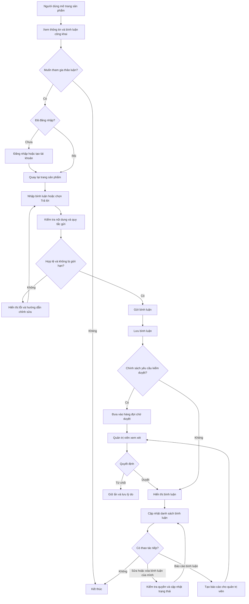
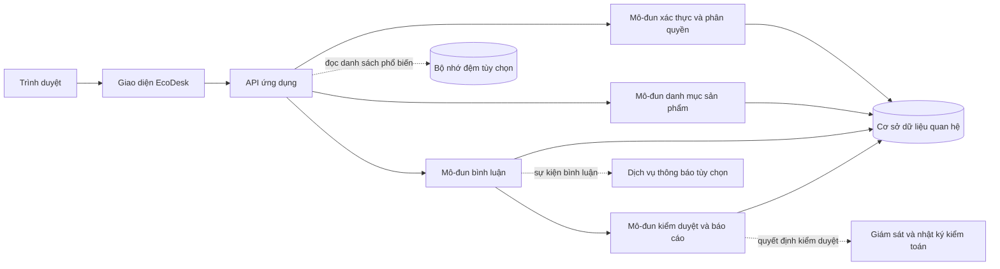
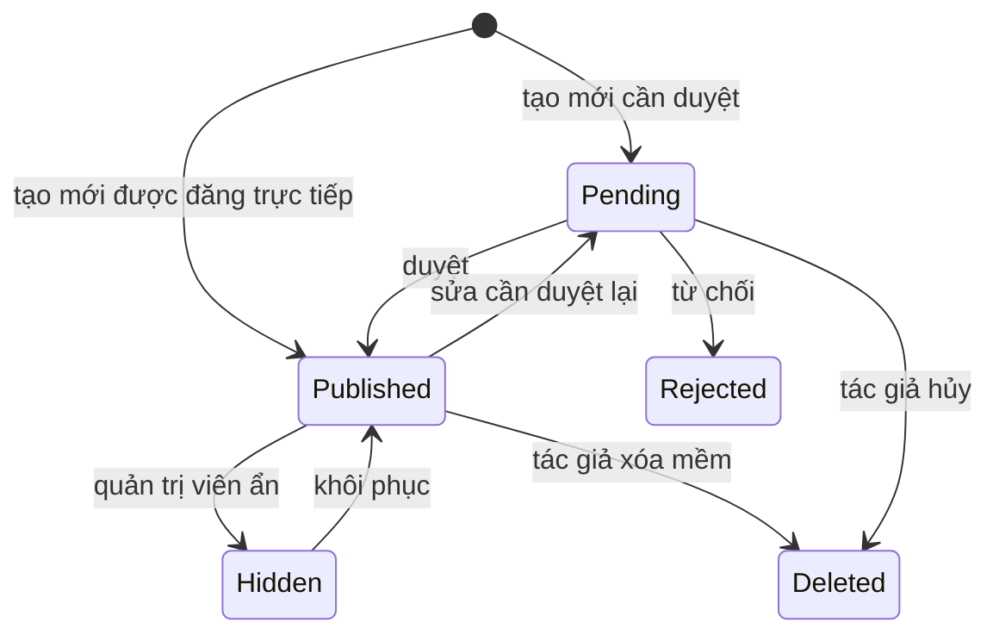

# EcoDesk — Thiết kế kiến trúc phần mềm: Bình luận sản phẩm

> **Trạng thái:** thiết kế đề xuất, cần đối chiếu với mã nguồn hiện tại.  
> **Phạm vi:** người dùng xem, tạo, sửa, xóa, trả lời và báo cáo bình luận trên trang sản phẩm; quản trị viên kiểm duyệt nội dung.

## 1. Mục tiêu

Mô tả quy trình nghiệp vụ và kiến trúc logic cho chức năng bình luận sản phẩm của EcoDesk. Thiết kế hướng đến trải nghiệm dễ hiểu, nội dung an toàn, phân quyền đúng và có thể mở rộng. Đây là đề xuất, không khẳng định các thành phần đã tồn tại trong ứng dụng.

## 2. Giả định và quy tắc nghiệp vụ

- Sản phẩm có trang chi tiết chứa danh sách bình luận.
- Khách có thể đọc bình luận công khai; để đăng, trả lời, sửa hoặc báo cáo cần đăng nhập.
- Người dùng chỉ được sửa hoặc xóa bình luận do chính mình tạo; quản trị viên có quyền kiểm duyệt.
- Bình luận có thể có một cấp phản hồi lồng nhau. Nếu cần nhiều cấp, cần giới hạn độ sâu để giao diện và truy vấn vẫn dễ quản lý.
- Nội dung mới có thể được đăng trực tiếp hoặc chuyển sang chờ duyệt theo cấu hình/chính sách.
- Bình luận bị ẩn, bị từ chối hoặc đang chờ duyệt không xuất hiện trong danh sách công khai.
- Chưa xác nhận framework, cơ sở dữ liệu, nhà cung cấp xác thực hay cách triển khai hiện tại của EcoDesk.

## 3. Workflow bình luận sản phẩm

### Luồng chính

1. Trang sản phẩm tải nội dung và danh sách bình luận công khai theo trang.
2. Khi người dùng gửi bình luận, giao diện kiểm tra dữ liệu cơ bản; máy chủ kiểm tra lại nội dung, phiên đăng nhập, quyền, giới hạn tần suất và trạng thái sản phẩm.
3. Hệ thống lưu bình luận cùng trạng thái ban đầu (`published` hoặc `pending`) trong cơ sở dữ liệu.
4. Bình luận được duyệt sẽ xuất hiện trong danh sách. Bình luận chờ duyệt chỉ hiển thị cho tác giả (nếu chính sách cho phép) và quản trị viên.
5. Tác giả có thể sửa hoặc xóa bình luận của mình. Việc sửa có thể đưa bình luận trở lại trạng thái chờ duyệt.
6. Người đọc có thể báo cáo bình luận. Báo cáo được đưa vào hàng đợi xử lý và không tự động xóa nội dung, trừ khi chính sách cấu hình yêu cầu ẩn tạm thời.
7. Mọi quyết định kiểm duyệt được ghi lại để tra cứu và kiểm toán.

## 4. Kiến trúc logic

### Trách nhiệm thành phần

| Thành phần | Trách nhiệm |
|---|---|
| Giao diện EcoDesk | Hiển thị bình luận, biểu mẫu viết/trả lời, trạng thái đang gửi, lỗi, phân trang và thao tác sửa/xóa/báo cáo. |
| API ứng dụng | Nhận yêu cầu từ giao diện, xác thực dữ liệu, điều phối mô-đun, phân trang, giới hạn tần suất và trả lỗi nhất quán. |
| Xác thực và phân quyền | Xác định người dùng; kiểm tra vai trò và quyền sở hữu bình luận ở phía máy chủ. |
| Danh mục sản phẩm | Cung cấp sản phẩm và xác nhận sản phẩm còn hoạt động, cho phép thảo luận. |
| Mô-đun bình luận | Tạo, đọc, sửa, xóa mềm, trả lời, lọc trạng thái và phân trang bình luận. |
| Kiểm duyệt và báo cáo | Tiếp nhận báo cáo, quản lý hàng đợi, duyệt/từ chối/ẩn nội dung và lưu lịch sử quyết định. |
| Dịch vụ thông báo (tùy chọn) | Thông báo cho tác giả khi có phản hồi hoặc quyết định kiểm duyệt; lỗi gửi thông báo không làm mất dữ liệu bình luận. |
| Cơ sở dữ liệu | Lưu sản phẩm, người dùng, bình luận, báo cáo và lịch sử kiểm duyệt một cách bền vững. |
| Bộ nhớ đệm (tùy chọn) | Tăng tốc đọc danh sách công khai; cần làm mới khi bình luận đổi trạng thái hoặc nội dung. |
| Giám sát và nhật ký | Ghi nhận lỗi, hiệu năng, sự kiện bảo mật và hành động kiểm duyệt; tránh ghi toàn bộ nội dung bình luận vào log. |

## 5. Mô hình dữ liệu logic

- **User**: `id`, trạng thái tài khoản, tên hiển thị, thời điểm tạo.
- **Product**: `id`, trạng thái, thông tin định danh và cấu hình cho phép bình luận.
- **Comment**: `id`, `product_id`, `author_id`, `parent_id` (tùy chọn), nội dung, trạng thái, `created_at`, `updated_at`, `deleted_at`, phiên bản.
- **CommentReport**: `id`, `comment_id`, `reporter_id`, lý do, trạng thái xử lý, thời điểm tạo.
- **ModerationAction**: `id`, `comment_id`, `moderator_id`, hành động, lý do, thời điểm tạo.

`parent_id` liên kết phản hồi với bình luận cha. Cần đảm bảo bình luận cha thuộc cùng sản phẩm và không vượt quá độ sâu cho phép. Xóa bình luận nên dùng xóa mềm để bảo toàn ngữ cảnh phản hồi và lịch sử kiểm duyệt; giao diện có thể thay nội dung bằng nhãn “Bình luận đã bị xóa”. Dùng chỉ mục cho `(product_id, status, created_at)` và `(parent_id, created_at)` để tải danh sách hiệu quả.

## 6. API tham khảo

| Phương thức và đường dẫn | Mục đích | Quyền truy cập |
|---|---|---|
| `GET /api/products/{id}/comments` | Lấy bình luận công khai theo trang; có thể lọc theo bình luận cha | Công khai |
| `POST /api/products/{id}/comments` | Tạo bình luận hoặc phản hồi | Người dùng đã đăng nhập |
| `PATCH /api/comments/{id}` | Sửa nội dung bình luận của mình | Tác giả; quản trị viên theo chính sách |
| `DELETE /api/comments/{id}` | Xóa mềm bình luận của mình | Tác giả; quản trị viên theo chính sách |
| `POST /api/comments/{id}/reports` | Báo cáo bình luận | Người dùng đã đăng nhập |
| `GET /api/moderation/comments` | Xem hàng đợi bình luận/báo cáo | Quản trị viên hoặc kiểm duyệt viên |
| `POST /api/moderation/comments/{id}/actions` | Duyệt, từ chối, ẩn hoặc khôi phục bình luận | Quản trị viên hoặc kiểm duyệt viên |

> Các đường dẫn trên chỉ mang tính minh họa; khi triển khai cần tuân thủ cấu trúc API hiện có của EcoDesk.

## 7. Trạng thái bình luận

Trạng thái thực tế cần được giới hạn bằng quy tắc chuyển trạng thái ở máy chủ. Không cho phép giao diện tự ý đặt trạng thái kiểm duyệt.

## 8. Bảo mật, quyền riêng tư và chất lượng

- **Phân quyền:** mọi thao tác sửa/xóa đều kiểm tra tác giả hoặc vai trò quản trị tại máy chủ; không dựa vào việc ẩn nút trên giao diện.
- **An toàn nội dung:** giới hạn độ dài và tần suất; làm sạch hoặc mã hóa đầu ra để phòng chống XSS; không hiển thị HTML tùy ý do người dùng gửi.
- **Chống lạm dụng:** giới hạn số lần gửi và báo cáo; có thể bổ sung phát hiện spam, CAPTCHA theo tín hiệu rủi ro và cơ chế chặn tài khoản.
- **CSRF và phiên đăng nhập:** dùng biện pháp bảo vệ phù hợp với cơ chế xác thực; cookie phiên cần cấu hình an toàn.
- **Quyền riêng tư:** chỉ lưu dữ liệu cần thiết; quy định thời hạn lưu báo cáo và nội dung đã xóa; giới hạn quyền xem hàng đợi kiểm duyệt.
- **Trợ năng:** thao tác bằng bàn phím, nhãn biểu mẫu rõ ràng, lỗi được thông báo dễ nhận biết, thứ tự tiêu điểm hợp lý.
- **Hiệu năng:** phân trang bằng con trỏ hoặc offset phù hợp; chỉ tải phản hồi khi cần; lập chỉ mục truy vấn; chỉ thêm bộ nhớ đệm khi số liệu cho thấy lợi ích.
- **Độ tin cậy:** lưu bình luận và trạng thái ban đầu trong một giao dịch; gửi thông báo bất đồng bộ; lỗi thông báo không hoàn tác bình luận.
- **Quan sát vận hành:** theo dõi thời gian phản hồi API, lỗi gửi/sửa, kích thước hàng đợi kiểm duyệt và báo cáo lạm dụng. Không ghi token, thông tin xác thực hoặc nội dung nhạy cảm vào log.

## 9. Triển khai và mở rộng

Ở giai đoạn đầu, triển khai các mô-đun sản phẩm, bình luận và kiểm duyệt trong cùng ứng dụng web, dùng cơ sở dữ liệu quan hệ hiện có hoặc được quản lý. Có thể thêm hàng đợi nền cho thông báo, phát hiện spam và xử lý kiểm duyệt khi cần. Tách dịch vụ chỉ khi lưu lượng, yêu cầu vận hành hoặc ranh giới đội ngũ tạo ra nhu cầu rõ ràng.

Tách môi trường phát triển, thử nghiệm và sản xuất. Quản lý bí mật ngoài mã nguồn; áp dụng migration có phiên bản; sao lưu dữ liệu và xác định quy trình khôi phục. Quyền kiểm duyệt cần được giới hạn theo vai trò và các hành động quan trọng phải có dấu vết kiểm toán.

## 10. Các điểm cần đối chiếu với mã nguồn EcoDesk

1. Framework, cấu trúc thư mục, định tuyến và quy ước API đang dùng.
2. Cơ chế đăng nhập, vai trò người dùng và cách kiểm tra quyền.
3. Cơ sở dữ liệu hiện tại, công cụ migration và các bảng liên quan đến sản phẩm/người dùng.
4. EcoDesk đã có bình luận, phản hồi, báo cáo hoặc trang quản trị nào chưa.
5. Chính sách đăng trực tiếp hay cần duyệt, quy tắc chỉnh sửa và thời hạn cho phép sửa/xóa.
6. Có cần nhiều cấp phản hồi, đính kèm ảnh, biểu tượng cảm xúc hoặc thông báo thời gian thực không.

## 11. Tiêu chí nghiệm thu

- Người đọc xem được bình luận công khai của sản phẩm theo thứ tự và phân trang rõ ràng.
- Người đã đăng nhập tạo được bình luận/phản hồi và nhận thông báo kết quả dễ hiểu.
- Tác giả chỉ sửa hoặc xóa được bình luận của mình; mọi quyền được kiểm tra ở máy chủ.
- Người dùng báo cáo được nội dung; quản trị viên xem hàng đợi và lưu quyết định kiểm duyệt.
- Bình luận bị ẩn, từ chối hoặc chờ duyệt không xuất hiện công khai.
- Nội dung đã xóa được xử lý nhất quán với phản hồi con và lịch sử kiểm duyệt.
- Chức năng dùng được bằng bàn phím, có giới hạn chống lạm dụng và không làm lộ nội dung nhạy cảm trong nhật ký.
